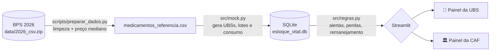
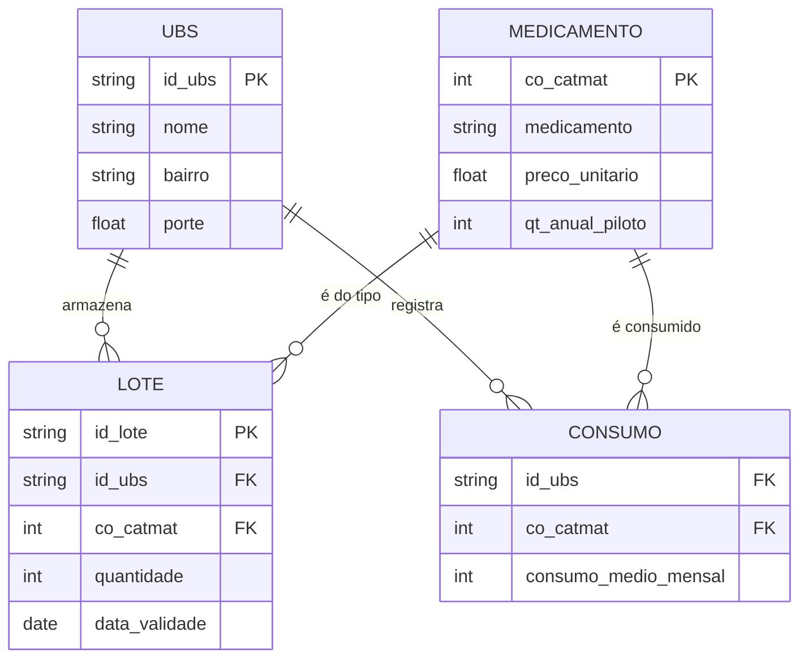
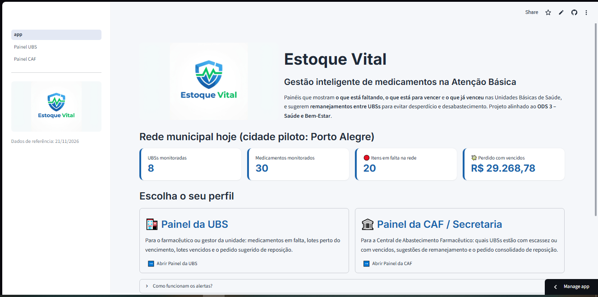
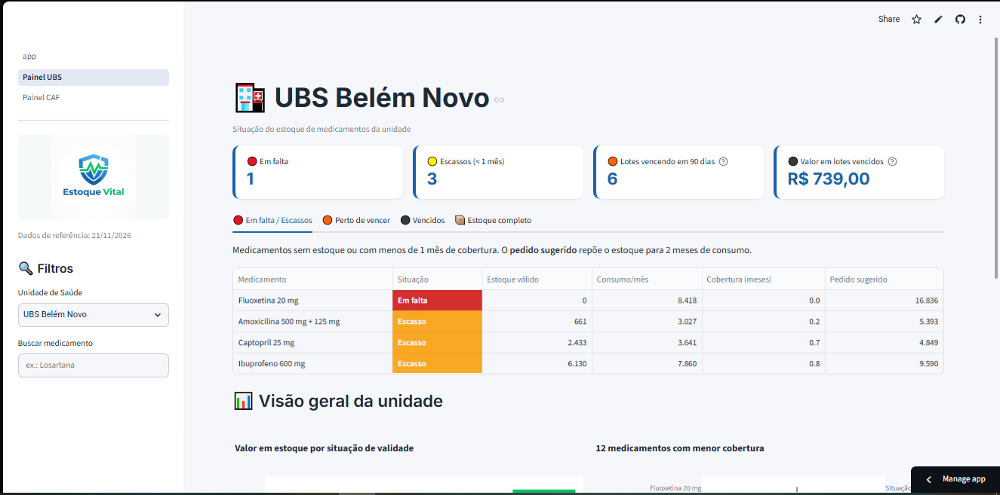
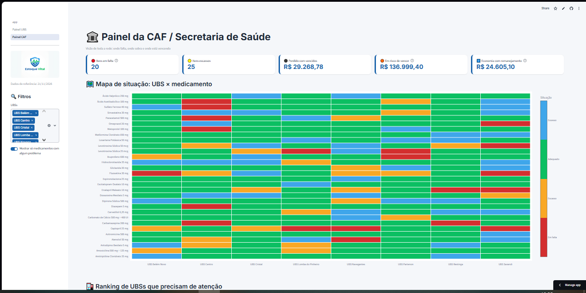
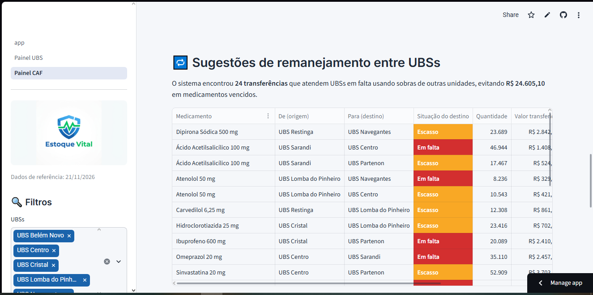

# 🏥 Estoque Vital

<p align="left">
  
</p>


> **Gestão inteligente de medicamentos na Atenção Básica:** painéis que mostram o que está **em falta**, o que está **para vencer** e o que **já venceu** nas UBSs, e sugerem **remanejamentos entre unidades** para evitar desperdício e desabastecimento.

🔗 **Protótipo online: [Acessar o Estoque Vital](https://fmu-tech---ods-jdcseamp3kpe2vy8zq77kl.streamlit.app/Painel_CAF)** 
🎬 **Vídeo de demonstração:** `COLE AQUI O LINK DO YOUTUBE (não listado)`

---

## 📑 Sumário
1. [Descrição do problema](#1--descrição-do-problema)
2. [Proposta de solução](#2--proposta-de-solução-tecnológica)
3. [Identidade visual](#3--identidade-visual)
4. [Pitch](#4--pitch)
5. [Protótipo (Checkpoint 2)](#5--protótipo-funcional-checkpoint-2)
6. [Como executar](#6-️-como-executar)
7. [Evolução desde o Checkpoint 1](#7--evolução-desde-o-checkpoint-1)
8. [Estrutura do repositório](#8--estrutura-do-repositório)
9. [Equipe](#-equipe-e-contribuições)

---

## 1. 🎯 Descrição do Problema

### O desafio
A rede pública de saúde convive com um paradoxo: pacientes saem das **Unidades Básicas de Saúde (UBSs)** sem medicamentos essenciais, enquanto em outras unidades da mesma cidade lotes do mesmo medicamento **vencem nas prateleiras** e são descartados. Em geral o problema não é falta de compra. É **falta de visibilidade** sobre onde cada lote está e quando ele vence.

### Público e contexto
* **Farmacêuticos e gestores de UBS:** precisam saber rapidamente o que falta, o que vence primeiro e o que deve ser descartado.
* **Central de Abastecimento Farmacêutico (CAF) / Secretaria Municipal de Saúde:** responsável por distribuir medicamentos entre as UBSs e decidir reposições e remanejamentos.
* **Pacientes do SUS**, em especial idosos e pessoas com doenças crônicas (hipertensão, diabetes, depressão), que dependem da retirada contínua de medicamentos.

**Cidade piloto do protótipo:** Porto Alegre (RS), que registrou **440 medicamentos diferentes** no BPS em 2026.

### Bases de dados públicas
| Base | Origem | Uso no projeto |
|---|---|---|
| **Banco de Preços em Saúde (BPS) 2026**: `data/2026_csv.zip` | Ministério da Saúde: [Banco de Preços em Saúde](https://www.gov.br/saude/pt-br/acesso-a-informacao/banco-de-precos) | **Dado real.** 15.163 registros de compras públicas de 2026 (item, quantidade, preço unitário, fornecedor, UF, município). Usado para definir **quais medicamentos** a rede compra, o **preço de referência** (mediana nacional) e o **consumo estimado** de cada UBS. |
| Estoques, lotes e validades por UBS | Simulados (`src/mock.py`) | Não existe base pública com o estoque de cada UBS. Os dados são **gerados a partir do BPS real**, como permite o Checkpoint 2. |

> ⚠️ **Observação sobre a base:** no BPS, a coluna `validade_compra` é a validade do **registro de preço** (em meses), **e não** a data de vencimento do lote. Por isso as validades dos lotes são simuladas.

**Principais colunas do BPS usadas:** `co_catmat` (código do medicamento), `ds_item`, `no_pdm`, `un_fornecimento`, `qt_medicamento`, `vl_preco_unitario`, `no_municipio`, `sg_uf`, `no_classe`.

---

## 2. 💻 Proposta de Solução Tecnológica

### Como a solução ataca o problema
O **Estoque Vital** é um sistema web com **dois painéis**, um para cada perfil de usuário:

| 🏥 Painel da UBS | 🏛️ Painel da CAF / Secretaria |
|---|---|
| Medicamentos **em falta** e **escassos** (< 1 mês de cobertura) | **Mapa de calor** UBS × medicamento com a situação de cada item |
| Lotes **perto de vencer** (≤ 30 dias crítico, 31 a 90 dias atenção) | **Ranking** das UBSs que precisam de atenção |
| Lotes **vencidos** e o valor perdido em R$ | **Desperdício em R$**: já vencido e que vai vencer sem uso |
| **Pedido sugerido** de reposição | ⭐ **Sugestões de remanejamento** entre UBSs |
| | **Pedido consolidado** de reposição com custo estimado pelo preço real do BPS |

### Regras de negócio (`src/regras.py`)
| Alerta | Regra |
|---|---|
| 🔴 Em falta | Estoque válido = 0 |
| 🟡 Escasso | Cobertura = estoque válido ÷ consumo mensal **< 1 mês** |
| 🔵 Excesso | Cobertura **> 3 meses** |
| 🟠 Vencimento crítico | Lote vence em **até 30 dias** |
| 🟡 Atenção | Lote vence entre **31 e 90 dias** |
| ⚫ Vencido | Data de validade anterior a hoje |
| 📉 Perda prevista | Simula o consumo no padrão FEFO (*primeiro que vence, primeiro que sai*) e calcula quantas unidades vencerão antes do uso |
| 🛒 Pedido sugerido | Quantidade para ficar com **2 meses** de estoque |
| 🔁 Remanejamento | Leva unidades de UBSs com excesso ou perda prevista (mantendo 1,5 mês de reserva e só lotes com 15 dias ou mais de validade) para UBSs **em falta ou escassas** |

### Stack tecnológica e justificativa
| Tecnologia | Uso | Por quê |
|---|---|---|
| **Python 3.11+** | Linguagem principal | Padrão em Ciência de Dados e conteúdo do curso |
| **Pandas / NumPy** | Limpeza do BPS, cálculo de cobertura, perdas e remanejamentos | Manipulação tabular simples e eficiente |
| **SQLite** | Banco relacional do protótipo (`data/estoque_vital.db`) | Persistência real sem precisar de servidor; vem embutido no Python |
| **Streamlit** | Interface web com múltiplas páginas e filtros | Permite um app funcional só com Python, sem front-end separado |
| **Plotly** | Gráficos interativos (barras, mapa de calor) | Interatividade (hover, zoom) integrada ao Streamlit |
| **Streamlit Community Cloud** | Hospedagem gratuita | Deploy direto do GitHub |

### Arquitetura


### Modelo de dados


---

## 3. 🎨 Identidade Visual

### Logotipo
O logotipo une um **escudo**, que representa a proteção do recurso público e da saúde do paciente, a uma **linha de batimento cardíaco** em verde, que simboliza vida e cuidado contínuo. O nome usa o azul institucional em "Estoque" e o verde em "Vital".

### Paleta de cores (extraída do logotipo + cores de alerta)
| Cor | Hex | Aplicação |
|---|---|---|
| 🟦 **Azul Institucional** | `#1A63AB` | Títulos, botões, cor primária do app |
| 🔷 **Azul Claro** | `#3FA6EA` | Status "Excesso" e destaques secundários |
| 🟩 **Verde Vital** | `#0BBF62` | Status "Adequado" e "OK" |
| 🟨 **Âmbar Alerta** | `#F9A825` | Status "Escasso" e "Atenção" (31 a 90 dias) |
| 🟥 **Vermelho Crítico** | `#D32F2F` | "Em falta" e "Vencido" |
| ⬜ **Cinza Gelo** | `#F5F7FA` | Fundo da aplicação |

As cores estão aplicadas no app em `src/ui.py` e em `.streamlit/config.toml`.

### Tipografia
* **Títulos:** `Inter` (SemiBold/Bold)
* **Textos e tabelas:** `Roboto` (Regular/Medium)

Ambas as fontes são carregadas do Google Fonts dentro do app.

---

## 4. 🚀 Pitch
> *"Em uma mesma cidade, um paciente sai da UBS sem o seu remédio de pressão enquanto, a poucos quilômetros, outra unidade descarta caixas do mesmo medicamento vencido. O **Estoque Vital** usa dados públicos reais de compras do SUS para dar visibilidade a esse problema: mostra para cada UBS o que falta e o que vai vencer, e mostra para a Secretaria de Saúde onde sobra, onde falta e **quanto dinheiro público pode ser salvo com um simples remanejamento**. Nosso diferencial é transformar alertas em **decisões prontas**: quem envia, quem recebe e quanto."*

---

## 5. 🖥️ Protótipo Funcional (Checkpoint 2)

### Fluxo principal
1. **Tela inicial:** visão geral da rede e escolha do perfil.
2. **Painel da UBS:** escolher a unidade na barra lateral e ver os indicadores e as abas *Em falta / Perto de vencer / Vencidos / Estoque completo*.
3. **Painel da CAF:** mapa de calor da rede, ranking de UBSs, **sugestões de remanejamento** (com download em CSV) e pedido consolidado de reposição.

### Prints do protótipo
<!-- Salve os prints em assets/prints/ com estes nomes -->
| Tela inicial | Painel da UBS |
|---|---|
|  |  |

| Painel da CAF: mapa de calor | Painel da CAF: remanejamentos |
|---|---|
|  |  |

### Dados reais × simulados
* **Reais (BPS 2026):** nomes dos 30 medicamentos, preços unitários de referência e quantidade anual comprada por Porto Alegre.
* **Simulados:** 8 UBSs fictícias (com nomes de bairros reais), consumo mensal (estimado a partir das compras reais), lotes e validades. As validades são geradas **em relação à data de hoje**, então o painel sempre mostra cenários atuais. A semente aleatória é fixa (`42`), então o cenário é sempre o mesmo.

---

## 6. ▶️ Como Executar

### Opção 1: online
Acesse o link do Streamlit Cloud no topo deste README.

### Opção 2: no seu computador
**Pré-requisitos:** [Python 3.11 ou superior](https://www.python.org/downloads/) e [Git](https://git-scm.com/).

```bash
# 1. Clonar o repositório
git clone https://github.com/Vinicius-prog-dev/Fmu-Tech---ODS.git
cd Fmu-Tech---ODS

# 2. (Opcional) criar um ambiente virtual
python -m venv .venv
# Windows: .venv\Scripts\activate     |     Linux/Mac: source .venv/bin/activate

# 3. Instalar as dependências
pip install -r requirements.txt

# 4. Rodar o app
streamlit run app.py
```
O navegador abre em `http://localhost:8501`. Na primeira execução o banco `data/estoque_vital.db` é criado automaticamente.

### (Opcional) Regerar a base de medicamentos a partir do BPS
```bash
python scripts/preparar_dados.py
```
O script lê `data/2026_csv.zip`, remove outliers de preço (valores acima de 10× ou abaixo de 1/10 da mediana do mesmo item) e gera `data/medicamentos_referencia.csv`.

---

## 7. 📈 Evolução desde o Checkpoint 1

| Checkpoint 1 | Checkpoint 2 |
|---|---|
| App Streamlit com apenas uma mensagem de teste | **App com 3 telas navegáveis**, filtros, gráficos interativos, tabelas e regras de negócio |
| Bases citadas de forma genérica | Base real identificada e tratada: **BPS 2026**, com limpeza de 327 outliers de preço |
| Proposta mencionava "validade dos lotes" do BPS | Corrigido: `validade_compra` é a validade do registro de preço, então **lotes e validades passaram a ser simulados** |
| Um único dashboard genérico | **Dois painéis por perfil:** UBS e CAF/Secretaria |
| Remanejamento citado só como ideia | **Algoritmo de remanejamento** implementado, com cálculo de perda evitada em R$ |
| SQLite apenas planejado | **SQLite em uso** (`src/banco.py`) |
| Paleta definida, mas diferente do logo | Paleta ajustada às cores reais do logotipo e aplicada no app |
| Retorno do Professor Mentor | `DESCREVA AQUI O QUE O PROFESSOR PEDIU E COMO FOI ATENDIDO` |

**Próximos passos (apresentação final):** permitir que a UBS registre entradas e saídas de lotes pela interface, adicionar histórico de consumo e testar outras cidades do BPS.

---

## 8. 📂 Estrutura do Repositório
```text
Fmu-Tech---ODS/
├── app.py                        # Tela inicial do Streamlit
├── pages/
│   ├── 1_Painel_UBS.py           # Painel da unidade de saúde
│   └── 2_Painel_CAF.py           # Painel da Central de Abastecimento / Secretaria
├── src/
│   ├── banco.py                  # Criação e leitura do banco SQLite
│   ├── mock.py                   # Geração dos dados simulados de estoque
│   ├── regras.py                 # Regras de alerta, perdas e remanejamento
│   └── ui.py                     # Paleta, fontes e componentes visuais
├── scripts/
│   └── preparar_dados.py         # Limpeza do BPS -> medicamentos_referencia.csv
├── data/
│   ├── 2026_csv.zip              # Base real BPS 2026
│   └── medicamentos_referencia.csv
├── notebooks/
│   └── Fmu_Tech_ODS.ipynb        # Exploração inicial da base
├── assets/
│   ├── logo.jpeg
│   └── prints/                   # Capturas de tela do protótipo
├── .streamlit/config.toml        # Tema com a paleta do projeto
├── requirements.txt
└── README.md
```

---

## 👥 Equipe e Contribuições
Projeto desenvolvido por estudantes do 2º semestre de **Ciência de Dados, Centro Universitário FMU**:

| Integrante | RA | Papel no projeto | GitHub |
|---|---|---|---|
| **Vinicius Galoa Fonseca Santos** | `2026110561` | Tratamento da base BPS (ETL), identidade visual e documentação | [@Vinicius-prog-dev](https://github.com/Vinicius-prog-dev) |
| **NOME DO INTEGRANTE 2** | `RA` | Regras de alerta e dados simulados | [@usuario](https://github.com/) |
| **NOME DO INTEGRANTE 3** | `RA` | Telas Streamlit, deploy e vídeo | [@usuario](https://github.com/) |

---
<sub>Medicamentos e preços: Banco de Preços em Saúde (BPS), Ministério da Saúde. UBSs, estoques e lotes: dados simulados para fins acadêmicos.</sub>
